# Técnicas de síntesis aplicadas al Parcial 2 (Realimentación N°2)
### Out = (y² + eˣ) / 4 con 1 sumador, 1 multiplicador y 1 desplazador >>1

> Esta guía reemplaza la versión anterior de este mismo archivo. Primero se explica **cómo se hace** cada técnica (con el ejemplo de la raíz que vieron en clase, para que veas de dónde salen los números de tus apuntes) y después se **desarrolla el parcial completo**:
>
> 1. Agrupación de variables (algoritmo del lado izquierdo) → registros.
> 2. Agrupación de operadores (partición de grafos) → unidades funcionales.
> 3. Agrupación de conexiones (partición de grafos) → buses.
> 4. Segmentación de la unidad funcional.
> 5. Segmentación del camino de datos (el método de las hojas 3 y 4 de Numbers).
>
> No se usan retardos en nanosegundos inventados: todo se mide en **estados (ciclos de reloj)**, como en la clase. Las figuras están en la carpeta [`figuras/`](figuras/) y se regeneran con `figuras/generar_figuras.py`.

---

## Índice

0. Respuesta corta: ¿lo de Numbers es la segmentación del camino de datos?
1. Mapa de las técnicas de síntesis y punto de partida (ASM del parcial)
2. Agrupación de variables (lado izquierdo)
3. Agrupación de operadores (partición de grafos)
4. Agrupación de conexiones: buses (partición de grafos)
5. Segmentación: idea y cómo se mide la ganancia
6. Segmentación de la unidad funcional (el multiplicador en dos etapas)
7. Segmentación del camino de datos (método de la clase)
8. Resumen comparativo y lista de chequeo para el examen

---

## 0. Respuesta corta: ¿lo de Numbers es la segmentación del camino de datos?

**Sí.** En tu material hay dos segmentaciones distintas y conviene no mezclarlas:

| Material | Qué es | Qué se parte |
|---|---|---|
| PDF *Técnicas de síntesis*, pág. 21 (la UF con **ET1 / ET2** y los cuadritos "registros necesarios en la segmentación") | **Segmentación de la unidad funcional** | Una sola unidad (el sumador/restador + MUX) se corta en dos etapas con registros internos |
| Numbers, **Hoja 3** "SEGMENTACIÓN DEL CD (UNA PARTE) – Agrupación de variables" | **Segmentación del camino de datos**, paso de registros | El ASM se corta con la línea roja en **Nivel Superior** y **Nivel Inferior**, y las variables se agrupan **en cada nivel por separado** |
| Numbers, **Hoja 4** "Análisis de tiempos – SEGMENTACIÓN el CD" | **Segmentación del camino de datos**, análisis de tiempos | Tabla ciclo a ciclo con un color por conjunto de datos y la tabla de ganancia (9/18/27 contra 8/12/16) |

"Una parte" significa **un corte**, es decir, **dos etapas** (dos niveles). En la sección 7.1 está la tabla de la Hoja 4 completa y explicada celda por celda.

---

## 1. Mapa de las técnicas de síntesis y punto de partida

De tu primera hoja: la síntesis de un ASM son los procedimientos que optimizan el hardware del CD y de la UC. Se dividen en dos familias:

| Familia | Técnica | Qué reduce | Herramienta | Sección |
|---|---|---|---|---|
| Recursos hardware | Agrupación de **variables** | registros | tabla de tiempos de vida + lado izquierdo | 2 |
| Recursos hardware | Agrupación de **operadores** | unidades funcionales | partición de grafos | 3 |
| Recursos hardware | Agrupación de **conexiones** | cables (se usan buses) | partición de grafos | 4 |
| Tiempo de procesamiento | **Pipeline** (segmentación) | tiempo por conjunto de datos | etapas + tabla de tiempos | 5–7 |
| Tiempo de procesamiento | Encadenamiento / multiciclo | estados o periodo | planificación | (guía de estudio, sec. 12) |

Las tres agrupaciones usan la misma regla: **dos cosas pueden compartir un recurso si nunca se usan en el mismo estado.**

### 1.1 El ASM del parcial

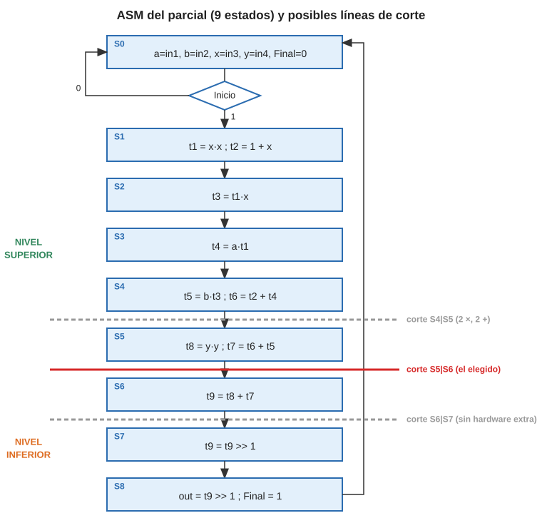

| Estado | Operaciones | Recursos usados |
|---|---|---|
| S0 | a = in1, b = in2, x = in3, y = in4, Final = 0 (espera Inicio) | – |
| S1 | t1 = x·x ; t2 = 1 + x | 1 ×, 1 + |
| S2 | t3 = t1·x | 1 × |
| S3 | t4 = a·t1 | 1 × |
| S4 | t5 = b·t3 ; t6 = t2 + t4 | 1 ×, 1 + |
| S5 | t8 = y·y ; t7 = t6 + t5 | 1 ×, 1 + |
| S6 | t9 = t8 + t7 | 1 + |
| S7 | t9 = t9 >> 1 | 1 >> |
| S8 | out = t9 >> 1 ; Final = 1 | 1 >> |

9 estados, Moore, sin señales de estado. Es el ASM corregido de la guía de estudio (E5). Las líneas de corte de la figura se usan en la sección 7.

---

## 2. Agrupación de variables (algoritmo del lado izquierdo)

### 2.1 Cómo se hace

Definiciones de tus apuntes:

- **Estado de escritura**: el estado siguiente a aquel donde la variable se asigna (el resultado se guarda al final del estado).
- **Estado de lectura**: el estado donde la variable se usa.
- **Tiempo de vida**: todos los estados desde el primer estado de escritura hasta el último de lectura, **sin huecos**.

Algoritmo del lado izquierdo:

1. Determinar los tiempos de vida (tabla variables × estados).
2. Ordenar las variables por estado de escritura (borde izquierdo); a igual inicio, por tiempo de vida.
3. Abrir un registro.
4. Recorrer la lista y meter en ese registro cada variable que **no se solape** con las que ya tiene.
5. Quitar del listado las asignadas y volver al paso 3 si quedan variables.

El número mínimo de registros es la columna con más X.

### 2.2 Desarrollo en el parcial

| Variable | S1 | S2 | S3 | S4 | S5 | S6 | S7 | S8 | Vida |
|---|---|---|---|---|---|---|---|---|---|
| y | X | X | X | X | X | | | | 5 |
| b | X | X | X | X | | | | | 4 |
| a | X | X | X | | | | | | 3 |
| x | X | X | | | | | | | 2 |
| t1 | | X | X | | | | | | 2 |
| t2 | | X | X | X | | | | | 3 |
| t3 | | | X | X | | | | | 2 |
| t4 | | | | X | | | | | 1 |
| t5 | | | | | X | | | | 1 |
| t6 | | | | | X | | | | 1 |
| t7 | | | | | | X | | | 1 |
| t8 | | | | | | X | | | 1 |
| t9 | | | | | | | X | X | 2 |
| **Vivas** | 4 | **6** | **6** | 5 | 3 | 2 | 1 | 1 | |

**Mínimo = 6 registros.** Lado izquierdo:

| Registro | Construcción | Variables |
|---|---|---|
| R1 | y(S1–S5) → t7(S6) → t9(S7–S8) | {y, t7, t9} |
| R2 | b(S1–S4) → t5(S5) → t8(S6) | {b, t5, t8} |
| R3 | a(S1–S3) → t4(S4) → t6(S5) | {a, t4, t6} |
| R4 | x(S1–S2) → t3(S3–S4) | {x, t3} |
| R5 | t2(S2–S4) | {t2} |
| R6 | t1(S2–S3) | {t1} |

### 2.3 Transferencias por estado (la tabla que usan las otras dos agrupaciones)

| Estado | Multiplicador (izq · der → destino) | Sumador (izq + der → destino) | Desplazador |
|---|---|---|---|
| S0 | carga: R1←in4, R2←in2, R3←in1, R4←in3 | | |
| S1 | R4 · R4 → R6 (t1) | R4 + "1" → R5 (t2) | |
| S2 | R4 · R6 → R4 (t3) | | |
| S3 | R3 · R6 → R3 (t4) | | |
| S4 | R2 · R4 → R2 (t5) | R3 + R5 → R3 (t6) | |
| S5 | R1 · R1 → R2 (t8) | R3 + R2 → R1 (t7) | |
| S6 | | R1 + R2 → R1 (t9) | |
| S7 | | | R1 >> 1 → R1 |
| S8 | | | R1 >> 1 → OUT |

Esta tabla dice, para cada operación, **de qué registros lee (fuentes)** y **en qué registro escribe (destino)**. Con eso se calculan los pesos de los grafos.

---

## 3. Agrupación de operadores (partición de grafos)

Objetivo: **reducir el número de unidades funcionales** agrupando operaciones similares (aritméticas, lógicas, de desplazamiento) que nunca coinciden en un estado.

### 3.1 El algoritmo (tu hoja "Agrupación de operadores")

1. **Generar los nodos**: un nodo por operación (como si cada operación tuviera su propia unidad).
2. **Identificar los arcos de incompatibilidad** (rojos punteados): dos operaciones son incompatibles si
   - están en el **mismo estado**, o
   - **ninguna unidad común** puede hacer las dos de forma barata.
   Entre las demás parejas se dibuja un arco de compatibilidad (amarillo).
3. **Evaluar los arcos prioritarios**: a cada arco amarillo se le pone el peso **f/d**:
   - **f** = número de **registros fuente en común** (registros que leen las dos operaciones),
   - **d** = número de **registros destino en común** (1 si escriben en el mismo registro, 0 si no).
   Juntar operaciones con fuentes comunes ahorra entradas de MUX a la entrada de la unidad; con destino común ahorra entradas de MUX en el registro.
4. **Tomar un supernodo**: elegir el arco de mayor peso (primero mayor f, luego mayor d) y unir sus dos nodos.
5. **Agrupar nodos** con estos criterios, en orden:
   - **No destrucción de otros arcos**: el supernodo solo conserva arcos hacia nodos compatibles con **todos** sus miembros; si hay empate, se prefiere la unión que destruya menos arcos.
   - **Peso del arco**: el peso del arco nuevo es la **suma** de los pesos hacia cada miembro.
   - **Supernodo con mayor número de elementos**.
   - **Indiferente** si todo empata.
6. **Actualizar el grafo**.
7. **Volver al paso 4** mientras queden arcos amarillos.

Cada supernodo final es **una unidad funcional**.

### 3.2 De dónde salen los pesos de tu grafo de clase

Este es el paso que suele quedar confuso. En el ejemplo de la raíz los registros eran R1 = {a, t1, x, t7}, R2 = {b, t2, y, t4, t6}, R3 = {t3, t5}. Cada operación lee y escribe en esos registros:

| Operación | Estado | Fuentes | Destino |
|---|---|---|---|
| \|a\| | S1 | R1 | R1 |
| \|b\| | S1 | R2 | R2 |
| máx1 = máx(t1,t2) | S2 | R1, R2 | R1 |
| mín = mín(t1,t2) | S2 | R1, R2 | R2 |
| − (t5 = x − t3) | S4 | R1, R3 | R3 |
| + (t6 = t5 + t4) | S5 | R3, R2 | R2 |
| máx2 = máx(t6,x) | S6 | R2, R1 | R1 |

Ejemplos de cálculo:

- **máx1 – máx2**: fuentes {R1,R2} y {R2,R1} → **2** en común; destinos R1 y R1 → **1** → peso **2/1**.
- **mín – máx2**: fuentes {R1,R2} y {R2,R1} → 2; destinos R2 y R1 → 0 → **2/0**.
- **|a| – máx1**: fuentes {R1} y {R1,R2} → 1; destinos R1 y R1 → 1 → **1/1**.
- **|b| – +**: fuentes {R2} y {R3,R2} → 1; destinos R2 y R2 → 1 → **1/1**.
- **+ – −**: fuentes {R3,R2} y {R1,R3} → 1; destinos R2 y R3 → 0 → **1/0**.
- **|a| – |b|** y **mín – máx1**: mismo estado → **incompatibles** (rojo).

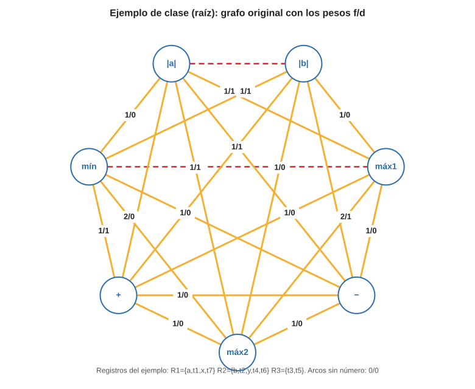

Con esa regla salen todos los números de tu "Grafo original" (1/0, 1/1, 2/0, 2/1). La secuencia del profesor fue:

| Paso | Arco elegido | Por qué | Resultado |
|---|---|---|---|
| 1 → 2 | máx1 – máx2 | mayor peso de todo el grafo (2/1) | SN1 = {máx1, máx2}; se pierde mín–máx2 porque mín es incompatible con máx1 |
| 2 → 3 | mín, \|b\|, + | triángulo de arcos 1/1 entre ellos (comparten R2 como fuente y destino) | SN2 = {mín, \|b\|, +} |
| 3 → 4 | \|a\| – SN1 (1/1) y − – SN2 (1/0) | \|a\| es incompatible con SN2 (por \|b\|) y − solo puede ir a un lado | **UF1 = {máx1, máx2, \|a\|}**, **UF2 = {mín, \|b\|, +, −}** |

Quedan 2 unidades funcionales (más los desplazadores, que se dejan aparte). Las dos se pueden construir con un sumador/restador y MUX (pág. 9 de tus apuntes), por eso se consideraron "similares".

### 3.3 Desarrollo en el parcial

**Paso 1: nodos.** Una operación por nodo:

| Nodo | Operación | Estado | Fuentes | Destino |
|---|---|---|---|---|
| M1 | t1 = x·x | S1 | R4 | R6 |
| M2 | t3 = t1·x | S2 | R4, R6 | R4 |
| M3 | t4 = a·t1 | S3 | R3, R6 | R3 |
| M4 | t5 = b·t3 | S4 | R2, R4 | R2 |
| M5 | t8 = y·y | S5 | R1 | R2 |
| A1 | t2 = 1 + x | S1 | R4, "1" | R5 |
| A2 | t6 = t2 + t4 | S4 | R5, R3 | R3 |
| A3 | t7 = t6 + t5 | S5 | R3, R2 | R1 |
| A4 | t9 = t8 + t7 | S6 | R2, R1 | R1 |
| D1 | t9 = t9 >> 1 | S7 | R1 | R1 |
| D2 | out = t9 >> 1 | S8 | R1 | OUT |

**Paso 2: arcos de incompatibilidad.**

- Por **estado**: M1–A1 (S1), M4–A2 (S4), M5–A3 (S5).
- Por **tipo**: el multiplicador no puede sumar y el sumador no puede multiplicar. Una unidad "×/+" tendría por dentro un multiplicador **y** un sumador, así que no ahorra nada. Por eso todo arco entre la familia × y la familia + es incompatible. El desplazamiento es otra familia (en tus apuntes los >>1 y >>3 también quedaron fuera del grafo). El enunciado, además, ya entrega las tres unidades por separado.
- **Dentro de cada familia no hay ninguna incompatibilidad**: nunca hay dos multiplicaciones, ni dos sumas, ni dos desplazamientos en el mismo estado. Eso ya lo garantizó el ASM al respetar los recursos.

**Paso 3: pesos f/d** (solo dentro de cada familia; los arcos entre familias son incompatibles):

| Familia × | Fuentes comunes | Destino común | Peso |
|---|---|---|---|
| M1–M2 | R4 | no (R6, R4) | **1/0** |
| M1–M4 | R4 | no | **1/0** |
| M2–M3 | R6 | no | **1/0** |
| M2–M4 | R4 | no | **1/0** |
| M4–M5 | ninguna | sí (R2) | **0/1** |
| M1–M3, M1–M5, M2–M5, M3–M4, M3–M5 | ninguna | no | 0/0 |

| Familia + | Fuentes comunes | Destino común | Peso |
|---|---|---|---|
| A3–A4 | R2 | sí (R1) | **1/1** |
| A2–A3 | R3 | no | **1/0** |
| A1–A2, A1–A3, A1–A4, A2–A4 | ninguna | no | 0/0 |

| Familia >> | Fuentes comunes | Destino común | Peso |
|---|---|---|---|
| D1–D2 | R1 | no (R1, OUT) | **1/0** |

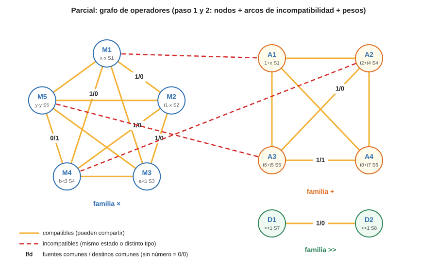

**Pasos 4 a 7: fusión.** En la familia ×:

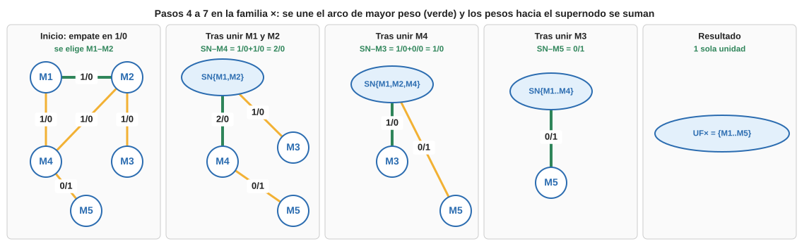

| Paso | Arcos disponibles (mayor primero) | Se une | Pesos nuevos hacia el supernodo |
|---|---|---|---|
| A | cuatro arcos 1/0 empatados | M1–M2 (indiferente entre los empatados) | SN–M3 = 0/0 + 1/0 = 1/0 · SN–M4 = 1/0 + 1/0 = **2/0** · SN–M5 = 0/0 |
| B | SN–M4 (2/0) | SN{M1,M2,M4} | SN–M3 = 1/0 + 0/0 = 1/0 · SN–M5 = 0/0 + 0/1 = 0/1 |
| C | SN–M3 (1/0) | SN{M1,M2,M3,M4} | SN–M5 = 0/1 |
| D | SN–M5 (0/1) | **UF× = {M1, M2, M3, M4, M5}** | ya no quedan arcos |

En la familia +: A3–A4 (1/1) → SN; SN–A2 = 1/0 + 0/0 = 1/0 → SN{A2,A3,A4}; SN–A1 = 0/0 → indiferente → **UF+ = {A1, A2, A3, A4}**. En la familia >>: D1–D2 → **UF>> = {D1, D2}**.

**Resultado: 3 unidades funcionales (1 multiplicador, 1 sumador, 1 desplazador).** Coincide con los recursos del enunciado, y la regla rápida lo confirma: unidades mínimas de un tipo = máximo de operaciones de ese tipo en un mismo estado = 1.

**¿Para qué sirvieron los pesos si al final todo quedó junto?** Cuando solo hay una unidad por tipo, los pesos no cambian el agrupamiento, pero sí indican **qué operandos van a cada entrada**. Por ejemplo, M1, M2 y M4 comparten la fuente R4: si R4 siempre entra por el mismo lado del multiplicador, ese MUX tiene una entrada menos. Con esa idea (y la conmutatividad a·b = b·a) se eligieron los lados de la tabla 2.3, que dan los MUX mínimos:

| Entrada | Fuentes | MUX |
|---|---|---|
| × izquierda (ML) | R4, R3, R2, R1 | 4:1 |
| × derecha (MR) | R4, R6, R1 | 3:1 |
| + izquierda (AL) | R4, R3, R1 | 3:1 |
| + derecha (AR) | "1", R5, R2 | 3:1 |
| >>1 | R1 | directo |
| R1 | in4, ADD, SH | 3:1 |
| R2 | in2, MUL | 2:1 |
| R3 | in1, MUL, ADD | 3:1 |
| R4 | in3, MUL | 2:1 |
| R5 / R6 | ADD / MUL | directo |

Ése es el camino de datos con variables y operadores agrupados (el dibujo completo y su palabra de control de 21 bits están en la guía de estudio, E5, pasos 7 a 9). Ahora toca reducir sus cables.

---

## 4. Agrupación de conexiones: buses (partición de grafos)

Objetivo (tu hoja "Agrupación de conexiones"): **reducir el número de cables** entre unidades funcionales y registros usando **buses** compartidos, con acceso por **three-state**, y decidir qué va a cada bus con el **algoritmo de grafos**.

### 4.1 Cómo se hace

1. **Etiquetar cada conexión** del CD con una letra. Una conexión es un cable "fuente → destino":
   - **parte superior**: registro → entrada de una unidad (lecturas),
   - **parte inferior**: salida de una unidad → registro (escrituras).
2. **Tabla de conexiones**: conexiones en filas, estados en columnas, una X donde la conexión se usa. Es igual a la tabla de tiempos de vida, pero con cables.
3. **Arcos de incompatibilidad**: dos conexiones son incompatibles si se usan en el **mismo estado** y llevan **datos distintos** (salen de fuentes distintas). Si salen de la misma fuente en el mismo estado llevan el mismo dato, y un bus puede repartirlo a varios destinos: **son compatibles**.
4. **Pesos**: se prioriza unir conexiones con la misma fuente (ahorra three-states) o el mismo destino (ahorra entradas de MUX).
5. **Partición** con los mismos pasos 4–7 de la sección 3.1. Cada supernodo final es **un bus**.

Se hace **por separado** para la parte superior y la inferior, como en tus hojas (Grafo parte superior → Bus 1 y Bus 2; Grafo parte inferior → Bus 3 y Bus 4).

> **Mínimo de buses = máximo número de datos distintos que viajan en un mismo estado** (la columna de la tabla con más fuentes distintas). Es la misma regla que "registros mínimos = máximo de variables vivas".

**Cómo lo hizo el profesor en la raíz** (para que reconozcas el método): las letras A–I eran lecturas y J–P escrituras. En la parte superior juntó casi todo lo que sale de R1 en el Bus 1 = {A, C, F, I, E} y lo que sale de R2 en el Bus 2 = {B, D, G, H}. En la inferior juntó por destino: el Bus 3 = {J, K, P} alimenta R1 y R3, y el Bus 4 = {L, M, N, O} alimenta R2 y R3. Por eso en su CD final R1 y R2 no necesitan MUX (cada uno lee de un solo bus) y solo R3 conserva uno (mux 7).

### 4.2 Las conexiones del parcial

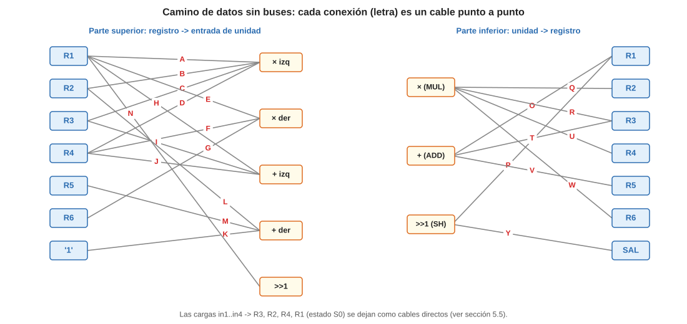

**Parte superior (lecturas).** Me salto la S y la X como letras para no confundirlas con los estados ni con las marcas de la tabla.

| Conexión | Fuente → destino | S1 | S2 | S3 | S4 | S5 | S6 | S7 | S8 |
|---|---|---|---|---|---|---|---|---|---|
| A | R1 → × izq | | | | | X | | | |
| B | R2 → × izq | | | | X | | | | |
| C | R3 → × izq | | | X | | | | | |
| D | R4 → × izq | X | X | | | | | | |
| E | R1 → × der | | | | | X | | | |
| F | R4 → × der | X | | | X | | | | |
| G | R6 → × der | | X | X | | | | | |
| H | R1 → + izq | | | | | | X | | |
| I | R3 → + izq | | | | X | X | | | |
| J | R4 → + izq | X | | | | | | | |
| K | "1" → + der | X | | | | | | | |
| L | R2 → + der | | | | | X | X | | |
| M | R5 → + der | | | | X | | | | |
| N | R1 → >>1 | | | | | | | X | X |
| **Datos distintos** | | 2 (R4, "1") | 2 | 2 | **4** (R2, R4, R3, R5) | 3 | 2 | 1 | 1 |

**Mínimo: 4 buses de lectura**, porque en S4 se leen b, t3, t4 y t2 a la vez, de cuatro registros distintos.

Arcos de incompatibilidad (mismo estado, distinta fuente):

| Estado | Incompatibles |
|---|---|
| S1 | D–K, F–K, J–K (D, F y J llevan x desde R4: entre ellas son compatibles) |
| S2 | D–G |
| S3 | C–G |
| S4 | B–F, B–I, B–M, F–I, F–M, I–M (las cuatro, todas contra todas) |
| S5 | A–I, A–L, E–I, E–L, I–L (A y E llevan y desde R1: compatibles) |
| S6 | H–L |

### 4.3 Partición de la parte superior

**Paso 1: unir lo que sale del mismo registro.** Dos conexiones de la misma fuente nunca chocan, y juntarlas hace que cada registro tenga **un solo three-state** hacia **un solo bus**. Quedan 7 supernodos: R1 = {A, E, H, N}, R2 = {B, L}, R3 = {C, I}, R4 = {D, F, J}, R5 = {M}, R6 = {G}, "1" = {K}.

**Paso 2: grafo de supernodos.** Dos supernodos son incompatibles si alguna pareja de sus conexiones lo es. El peso **d** cuenta las entradas de unidad que comparten (si van al mismo bus, esa entrada necesita un MUX más pequeño).

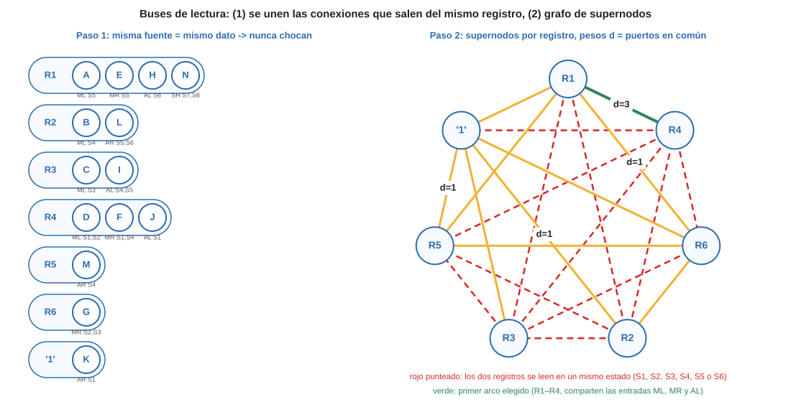

| Pareja compatible | Entradas en común | d |
|---|---|---|
| R1 – R4 | × izq, × der, + izq | **3** |
| R1 – R6 | × der | 1 |
| R2 – "1" | + der | 1 |
| R5 – "1" | + der | 1 |
| R1–R5, R1–"1", R2–R6, R3–"1", R5–R6, R6–"1" | ninguna | 0 |

**Pasos 4 a 7:**

| Paso | Se une | Por qué | Arcos que se pierden |
|---|---|---|---|
| 1 | R1 + R4 → Bus C | mayor peso (d = 3) | R1–R5, R1–R6, R1–"1" (R4 es incompatible con R5, R6 y "1") |
| 2 | R5 + "1" → Bus D | empate en d = 1 con R2–"1"; las dos uniones destruyen 2 arcos y crean un supernodo de 2 → indiferente | R2–"1", R3–"1" |
| 3 | R2 + R6 → Bus A | quedan arcos de peso 0 (R2–R6 y {R5,"1"}–R6) → indiferente | {R5,"1"}–R6 |
| 4 | R3 queda solo → Bus B | ya no tiene arcos compatibles | – |

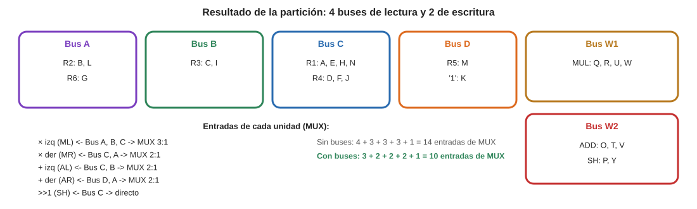

**4 buses de lectura**, que es el mínimo. Además, el MUX de cada entrada ahora elige entre **buses** y no entre registros, y como R1 y R4 comparten bus, varias entradas se achican: de 14 entradas de MUX se pasa a 10.

### 4.4 Partición de la parte inferior

| Conexión | Fuente → destino | S1 | S2 | S3 | S4 | S5 | S6 | S7 | S8 |
|---|---|---|---|---|---|---|---|---|---|
| O | ADD → R1 | | | | | X | X | | |
| P | SH → R1 | | | | | | | X | |
| Q | MUL → R2 | | | | X | X | | | |
| R | MUL → R3 | | | X | | | | | |
| T | ADD → R3 | | | | X | | | | |
| U | MUL → R4 | | X | | | | | | |
| V | ADD → R5 | X | | | | | | | |
| W | MUL → R6 | X | | | | | | | |
| Y | SH → OUT | | | | | | | | X |
| **Datos distintos** | | 2 | 1 | 1 | 2 | 2 | 1 | 1 | 1 |

**Mínimo: 2 buses de escritura.** Incompatibles: V–W (S1), Q–T (S4), O–Q (S5).

Partición: por fuente salen tres supernodos, MUL = {Q, R, U, W}, ADD = {O, T, V} y SH = {P, Y}. MUL y ADD chocan (S1, S4, S5). SH es compatible con los dos; con ADD comparte el destino R1 (O y P), con MUL no comparte nada → se une a ADD.

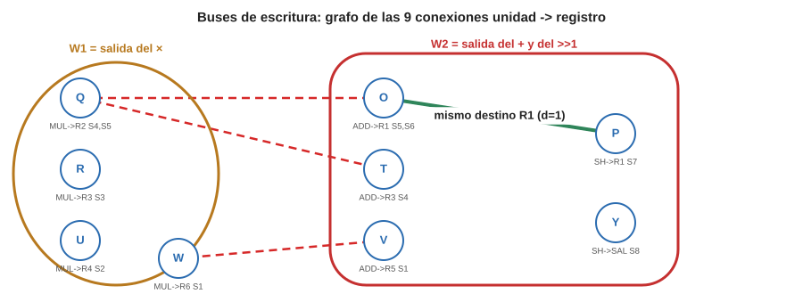

- **Bus W1** = salida del multiplicador (es la única fuente: no necesita three-state).
- **Bus W2** = salida del sumador **o** del desplazador, cada una con su three-state (tADD, tSH). Nunca escriben en el mismo estado.

### 4.5 ¿Y las entradas in1…in4?

En la raíz el profesor metió las cargas de in1 e in2 en los buses de escritura (K y M), porque eran solo dos y ya hacían falta dos buses. En el parcial **las cuatro cargas ocurren a la vez en S0** y son cuatro datos distintos: si fueran por los buses harían falta **4 buses de escritura** solo por ese estado. Por eso se dejan como cables directos a los MUX de R1…R4. (Otra opción válida sería cargar en dos estados, a costa de un estado más.)

### 4.6 Camino de datos final con buses

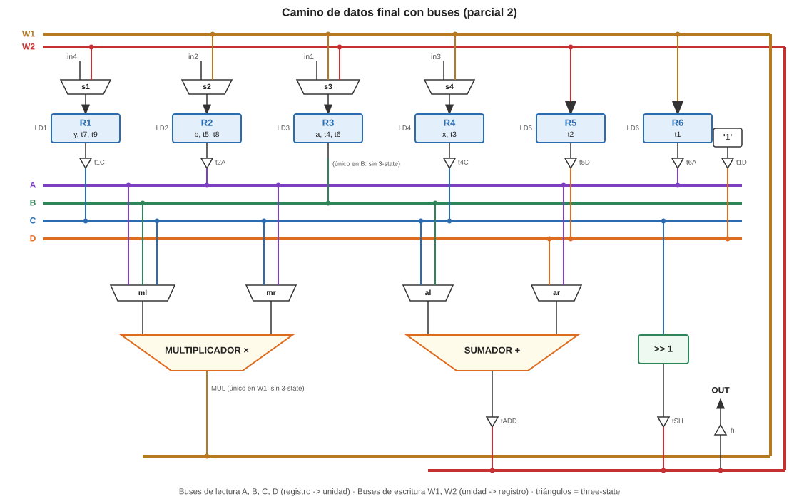

| Elemento | Conexión |
|---|---|
| Bus A | R2 (three-state t2A) y R6 (t6A) |
| Bus B | R3 (única fuente, cable directo) |
| Bus C | R1 (t1C) y R4 (t4C) |
| Bus D | R5 (t5D) y la constante "1" (t1D) |
| × izq ← | Bus A, B o C (MUX 3:1, `ml`) |
| × der ← | Bus C o A (MUX 2:1, `mr`) |
| + izq ← | Bus C o B (MUX 2:1, `al`) |
| + der ← | Bus D o A (MUX 2:1, `ar`) |
| >>1 ← | Bus C (directo) |
| R1 ← in4 o W2 · R2 ← in2 o W1 · R3 ← in1, W1 o W2 · R4 ← in3 o W1 · R5 ← W2 · R6 ← W1 | MUX de registros |
| OUT ← W2 | three-state h |

**Regla de oro de los buses:** en cada estado, como máximo **un** three-state encendido por bus. La palabra de control lo tiene que garantizar.

### 4.7 Palabra de control con buses

Codificación: `ml` 00 = A, 01 = B, 10 = C · `mr` 0 = A, 1 = C · `al` 0 = B, 1 = C · `ar` 0 = A, 1 = D · `s1` 0 = in4, 1 = W2 · `s2` 0 = in2, 1 = W1 · `s3` 00 = in1, 01 = W1, 10 = W2 · `s4` 0 = in3, 1 = W1.

| Estado | t2A | t6A | t1C | t4C | t5D | t1D | ml | mr | al | ar | tADD | tSH | s1 LD1 | s2 LD2 | s3 LD3 | s4 LD4 | LD5 | LD6 | h | Final |
|---|---|---|---|---|---|---|---|---|---|---|---|---|---|---|---|---|---|---|---|---|
| S0 | 0 | 0 | 0 | 0 | 0 | 0 | XX | X | X | X | 0 | 0 | 0 1 | 0 1 | 00 1 | 0 1 | 0 | 0 | 0 | 0 |
| S1 | 0 | 0 | 0 | 1 | 0 | 1 | 10 | 1 | 1 | 1 | 1 | 0 | X 0 | X 0 | XX 0 | X 0 | 1 | 1 | 0 | 0 |
| S2 | 0 | 1 | 0 | 1 | 0 | 0 | 10 | 0 | X | X | 0 | 0 | X 0 | X 0 | XX 0 | 1 1 | 0 | 0 | 0 | 0 |
| S3 | 0 | 1 | 0 | 0 | 0 | 0 | 01 | 0 | X | X | 0 | 0 | X 0 | X 0 | 01 1 | X 0 | 0 | 0 | 0 | 0 |
| S4 | 1 | 0 | 0 | 1 | 1 | 0 | 00 | 1 | 0 | 1 | 1 | 0 | X 0 | 1 1 | 10 1 | X 0 | 0 | 0 | 0 | 0 |
| S5 | 1 | 0 | 1 | 0 | 0 | 0 | 10 | 1 | 0 | 0 | 1 | 0 | 1 1 | 1 1 | XX 0 | X 0 | 0 | 0 | 0 | 0 |
| S6 | 1 | 0 | 1 | 0 | 0 | 0 | XX | X | 1 | 0 | 1 | 0 | 1 1 | X 0 | XX 0 | X 0 | 0 | 0 | 0 | 0 |
| S7 | 0 | 0 | 1 | 0 | 0 | 0 | XX | X | X | X | 0 | 1 | 1 1 | X 0 | XX 0 | X 0 | 0 | 0 | 0 | 0 |
| S8 | 0 | 0 | 1 | 0 | 0 | 0 | XX | X | X | X | 0 | 1 | X 0 | X 0 | XX 0 | X 0 | 0 | 0 | 1 | 1 |

Comprobación de S4: el bus A lleva b (solo t2A = 1), el bus B lleva t4, el bus C lleva t3 (solo t4C = 1), el bus D lleva t2 (solo t5D = 1). El × toma A y C (b·t3) y escribe por W1 en R2; el + toma B y D (t4 + t2) y escribe por W2 en R3. ✓

**Balance de los buses:** la palabra de control pasa de 21 a **25 bits** (aparecen los habilitadores de los three-state), y la ROM de salida de la UC pasa de 16 × 22 a **16 × 26**. A cambio, el CD tiene 6 buses en lugar de 23 cables punto a punto y los MUX de las unidades bajan de 14 a 10 entradas. La UC sigue teniendo 9 estados, así que la ROM de entrada no cambia (32 × 4).

---

## 5. Segmentación: idea y cómo se mide la ganancia

De tu hoja "Segmentación (Pipeline)": se divide el sistema en **etapas separadas por registros**, de modo que cada etapa trabaja de forma casi independiente. El retardo de cada etapa es menor que el del circuito completo, e idealmente con N etapas el tiempo se reduce a 1/N.

Dos formas de aprovecharlo:

| | Segmentar la **unidad funcional** | Segmentar el **camino de datos** |
|---|---|---|
| Qué se corta | una unidad (aquí, el multiplicador) | el ASM completo, en Nivel Superior y Nivel Inferior |
| Qué gana | **reloj más rápido** (cada etapa hace la mitad del trabajo) | **solapar conjuntos de datos** (mientras el NI termina el conjunto k, el NS ya trabaja el k+1) |
| Qué cuesta | registros internos en la unidad y operaciones que tardan 2 ciclos | duplicar unidades (cada nivel tiene las suyas) y más registros |
| Cómo se mide | tiempo = estados × periodo | estados totales para 1, 2, 3… conjuntos |

Fórmulas que se usan en las dos:

- **Ganancia** = tiempo sin segmentar / tiempo segmentado.
- **% de mejora** = (tiempo sin − tiempo con) / tiempo sin. Es lo que calcula tu tabla de Numbers (0,11 / 0,33 / 0,41).

---

## 6. Segmentación de la unidad funcional (el multiplicador en dos etapas)

### 6.1 Cómo se hace

1. **Elegir la unidad a cortar**: la más lenta, porque es la que fija el periodo de reloj. En el parcial es el **multiplicador** (un multiplicador de n bits es por dentro una matriz de sumadores, mucho más lento que el sumador).
2. **Cortarla en dos etapas** de retardo parecido y poner **registros de segmentación** en el corte. Esos registros guardan **todo lo que la etapa 2 necesita**: los resultados parciales y también los operandos que se siguen usando (son los cuadritos de tu pág. 21, donde se guardan A, B y la salida del sumador para que los MUX de la etapa 2 puedan elegir).
3. **Nuevo reloj**: T' ≈ T/2 en el caso ideal (supuesto: el sumador y el desplazador caben en medio periodo, lo normal).
4. **Nueva regla de tiempos**: una multiplicación **lanzada en ck** pasa por la etapa 2 en ck+1 y su resultado **se puede leer en ck+2**. El multiplicador acepta una multiplicación nueva **cada ciclo**.
5. **Replanificar el ASM** respetando esa regla y usando los huecos de la etapa 1 para operaciones independientes.
6. **Calcular la ganancia**: (estados sin × T) / (estados con × T/2).

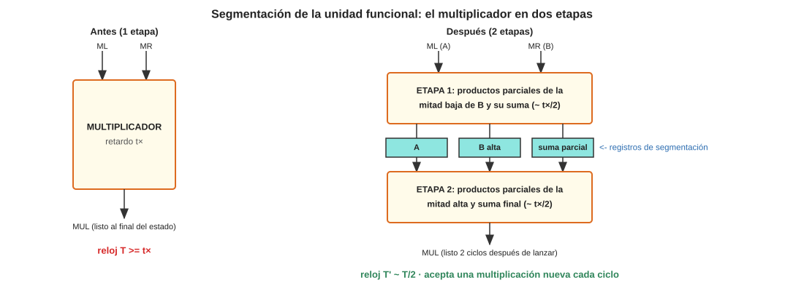

### 6.2 Replanificación del parcial

| Ciclo | Lanza en × (etapa 1) | En etapa 2 (se guarda al final) | Sumador | >>1 | Comprobación |
|---|---|---|---|---|---|
| c0 | carga a, b, x, y | | | | |
| c1 | t1 = x·x | | t2 = 1 + x | | x, a, b, y cargados en c0 ✓ |
| c2 | t8 = y·y | t1 | | | y no depende de nada ✓ |
| c3 | t3 = t1·x | t8 | | | t1 lanzado en c1 → listo en c3 ✓ |
| c4 | t4 = a·t1 | t3 | | | t1 ✓ |
| c5 | t5 = b·t3 | t4 | | | t3 lanzado en c3 → listo en c5 ✓ |
| c6 | | t5 | t6 = t2 + t4 | | t4 lanzado en c4 → listo en c6 ✓ |
| c7 | | | t7 = t6 + t5 | | t5 lanzado en c5 → listo en c7 ✓ |
| c8 | | | t9 = t8 + t7 | | t8 listo desde c4 ✓ |
| c9 | | | | t9 = t9 >> 1 | |
| c10 | | | | out = t9 >> 1, Final = 1 | |

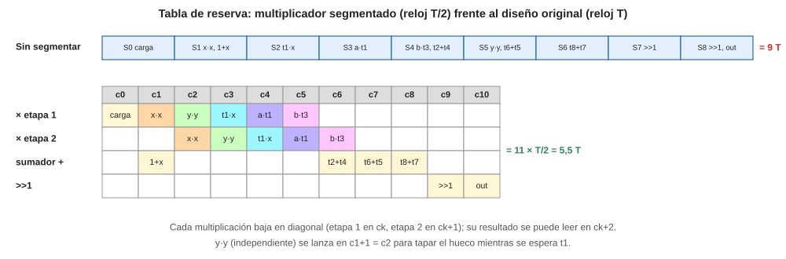

El camino crítico es x·x → t1·x → b·t3 → t7 → t9 → >>1 → >>1: 2 + 2 + 2 + 1 + 1 + 1 + 1 = **10 ciclos**, así que esta planificación es la mínima. t3 se lanza antes que t4 porque está en el camino crítico (t5 depende de t3). y·y puede ir en cualquier ciclo entre c2 y c6 sin cambiar el total; aquí se pone en c2 para mostrar cómo se ocupa un hueco de la etapa 1.

### 6.3 Registros con la nueva planificación

| Variable | c1 | c2 | c3 | c4 | c5 | c6 | c7 | c8 | c9 | c10 |
|---|---|---|---|---|---|---|---|---|---|---|
| a | X | X | X | X | | | | | | |
| b | X | X | X | X | X | | | | | |
| x | X | X | X | | | | | | | |
| y | X | X | | | | | | | | |
| t1 | | | X | X | | | | | | |
| t2 | | X | X | X | X | X | | | | |
| t8 | | | | X | X | X | X | X | | |
| t3 | | | | | X | | | | | |
| t4 | | | | | | X | | | | |
| t5, t6 | | | | | | | X | | | |
| t7 | | | | | | | | X | | |
| t9 | | | | | | | | | X | X |
| **Vivas** | 4 | 5 | **6** | 5 | 4 | 3 | 3 | 2 | 1 | 1 |

Siguen haciendo falta **6 registros** (más los registros internos del multiplicador, que no cuentan como registros del CD).

### 6.4 Ganancia

| | Estados | Periodo | Tiempo por conjunto |
|---|---|---|---|
| Sin segmentar | 9 (S0–S8) | T | **9 T** |
| Multiplicador segmentado | 11 (c0–c10) | T/2 | **5,5 T** |

- **Ganancia = 9 / 5,5 = 1,64.**
- **% de mejora = (9 − 5,5) / 9 = 0,39.**
- La ideal con 2 etapas sería 2 (50 %). Se pierde porque el algoritmo es muy encadenado: casi cada multiplicación espera a la anterior, y la etapa 1 queda vacía desde c6.

### 6.5 Qué cambia en la unidad de control

- 11 estados → 4 bits. ROM de entrada 2^(4+1) × 4 = **32 × 4**. ROM de salida **16 × (bits de PC + 1)**.
- En cada palabra de control se mezclan **dos multiplicaciones**: los selectores de ML y MR son de la que se **lanza** en ese ciclo, y el LD del registro destino es de la que se lanzó el ciclo **anterior**. Por ejemplo, en c3 los MUX eligen R4 y R6 (t1·x) mientras se carga t8 (y·y, lanzada en c2).

---

## 7. Segmentación del camino de datos (método de la clase)

### 7.1 Lo que hicieron en clase, explicado

El ASM de la clase (pág. 21) usa **una sola UF** (la que hace +, −, máx, mín, |·|) con los desplazadores encadenados a su salida:

| Nivel | Estado | Operación |
|---|---|---|
| Superior | S0 | a = in1, b = in2 |
| Superior | S1 | t1 = \|a\| |
| Superior | S2 | t2 = \|b\| |
| Superior | S3 | x = máx(t1,t2) ; t3 = máx(t1,t2) >> 3 |
| Superior | S4 | t4 = mín(t1,t2) >> 1 |
| — | — | **línea roja** |
| Inferior | S5 | t5 = x − t3 |
| Inferior | S6 | t6 = t5 + t4 |
| Inferior | S7 | t7 = máx(t6, x) |
| Inferior | S8 | Sal = t7, Final = 1 |

**Hoja 3 (agrupación de variables por nivel).** Cada nivel tiene sus propios registros, y por eso la tabla de vida se hace por separado:

| Nivel superior | s1 | s2 | s3 | s4 | | Nivel inferior | s4 | s5 | s6 | s7 | s8 |
|---|---|---|---|---|---|---|---|---|---|---|---|
| b | X | X | | | | x | X | X | X | X | |
| a | X | | | | | t3 | X | X | | | |
| t1 | | X | X | X | | t4 | | X | X | | |
| t2 | | | X | X | | t5 | | | X | | |
| | | | | | | t6 | | | | X | |
| | | | | | | t7 | | | | | X |
| **Vivas** | 2 | 2 | 2 | 2 | | **Vivas** | 2 | 3 | 3 | 2 | 1 |

→ NS: R1 = {b, t2}, R2 = {a, t1}. NI: R3 = {x, t7}, R4 = {t3, t5, t6}, R5 = {t4}. Las variables que **cruzan** el corte (x, t3, t4) las escribe la UF del nivel superior **directamente en registros del nivel inferior**: no hace falta un registro de frontera aparte.

**Hoja 4 (análisis de tiempos).** Filas = elementos del CD (lecturas de cada registro, UF de cada nivel, desplazadores, escrituras, salida); columnas = estados; un color por conjunto de datos. Completada para tres conjuntos:

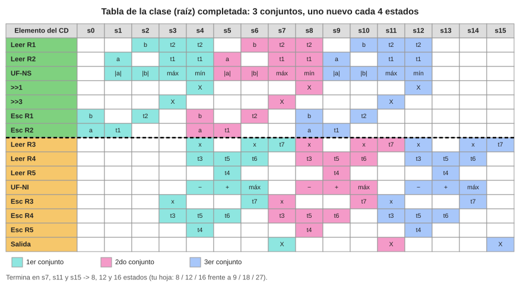

Reglas con las que se llena (sirven para cualquier ejercicio):

1. Una operación ocupa **una columna**: en esa columna se leen sus registros, trabaja la UF y se marca la escritura de su resultado, que queda disponible en la columna siguiente.
2. Cada UF hace **una** operación por columna y cada registro se escribe **una** vez por columna.
3. Un nivel arranca una operación **en cuanto sus datos están escritos**. Por eso la resta del NI va en **s4** y no en s5 como en el ASM: x y t3 se escribieron en s3, y la resta no necesita t4. Esa resta se solapa con el mín del NS. De ahí sale el **8** del primer conjunto (en vez de 9).
4. El siguiente conjunto entra en cuanto el NS lo permite. La carga del 2.º conjunto (Esc R1 = b, Esc R2 = a, en rosa) va en **s4**, el mismo estado en que el mín lee por última vez R1 y R2: se lee el valor viejo y al final del estado se guarda el nuevo.
5. A partir de ahí el patrón se repite desplazado **4 columnas** (el periodo del NS).

Resultado: el 1.º conjunto sale en s7, el 2.º en s11 y el 3.º en s15 → **8, 12 y 16 estados**, frente a 9, 18 y 27 sin segmentar → mejora 0,11 / 0,33 / 0,41. Son exactamente los números de tu hoja.

### 7.2 Parcial – Paso 1: elegir la línea de corte

Cada nivel necesita **sus propias unidades**. El corte se elige mirando tres cosas: qué unidades hay que duplicar, cuántos estados tiene cada nivel (el más largo fija cada cuánto entra un conjunto) y cuántas variables cruzan el corte.

| Corte | Nivel superior | Nivel inferior | Hardware extra | Estados NS / NI | Entra un conjunto cada | 1 / 2 / 3 conjuntos |
|---|---|---|---|---|---|---|
| S4\|S5 | S1–S4 (×, +) | S5–S8 (×, +, >>) | **+1 ×, +1 +** | 4 / 4 | 4 estados | 9 / 13 / 17 |
| **S5\|S6** | S1–S5 (×, +) | S6–S8 (+, >>) | **+1 +** | 5 / 3 | **5 estados** | **9 / 14 / 19** |
| S6\|S7 | S1–S6 (×, +) | S7–S8 (>>) | ninguno | 6 / 2 | 6 estados | 9 / 15 / 21 |

- El corte S4|S5 es el más equilibrado (4 y 4) y el más rápido, pero obliga a poner **un segundo multiplicador** en el NI solo para y·y.
- El corte S6|S7 no duplica nada (el desplazador ya era una unidad aparte), pero el NS queda de 6 estados.
- **Se elige S5|S6**: las 5 multiplicaciones quedan en el NS con un solo multiplicador (que es la unidad cara) y solo se duplica el sumador. Con un solo multiplicador ningún corte puede bajar de 5 estados por conjunto, porque hay 5 multiplicaciones.

Variables que cruzan el corte: **t7 y t8** (las escribe el NS en registros del NI, como x y t3 en la clase).

### 7.3 Parcial – Paso 2: agrupación de variables por nivel

**Nivel superior (S1–S5):**

| Variable | S1 | S2 | S3 | S4 | S5 | Vida |
|---|---|---|---|---|---|---|
| y | X | X | X | X | X | 5 |
| b | X | X | X | X | | 4 |
| a | X | X | X | | | 3 |
| x | X | X | | | | 2 |
| t1 | | X | X | | | 2 |
| t2 | | X | X | X | | 3 |
| t3 | | | X | X | | 2 |
| t4 | | | | X | | 1 |
| t5 | | | | | X | 1 |
| t6 | | | | | X | 1 |
| **Vivas** | 4 | **6** | **6** | 5 | 3 | |

→ 6 registros: **R1 = {y}**, **R2 = {b, t5}**, **R3 = {a, t4, t6}**, **R4 = {x, t3}**, **R5 = {t2}**, **R6 = {t1}**.

**Nivel inferior (S6–S8):**

| Variable | S6 | S7 | S8 | Vida |
|---|---|---|---|---|
| t7 | X | | | 1 |
| t8 | X | | | 1 |
| t9 | | X | X | 2 |
| **Vivas** | **2** | 1 | 1 | |

→ 2 registros: **R7 = {t7, t9}**, **R8 = {t8}**. Total: 6 + 2 = **8 registros** (el diseño sin segmentar usaba 6).

### 7.4 Parcial – Paso 3: el camino de datos de cada nivel

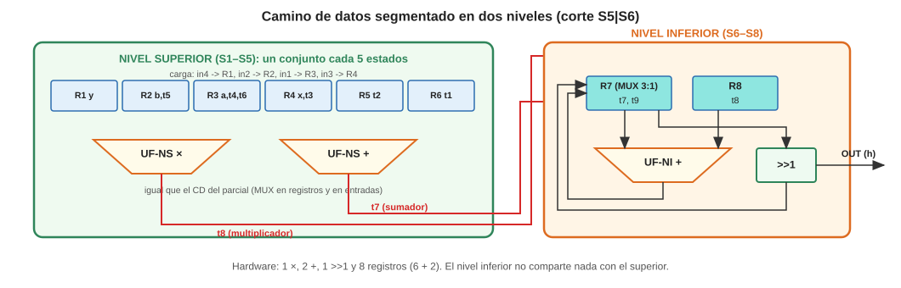

- **NS**: el mismo CD del parcial (multiplicador, sumador, MUX), pero ahora el multiplicador también escribe en R8 (t8) y el sumador en R7 (t7). R1 ya solo se carga desde in4.
- **NI**: un sumador propio (UF-NI +) que siempre suma R7 + R8, el desplazador (siempre lee R7) y un MUX 3:1 en R7 (t7 del NS, t9 de la UF-NI, t9 del desplazador). La salida sale del desplazador por el three-state h.

### 7.5 Parcial – Paso 4: tabla de análisis de tiempos

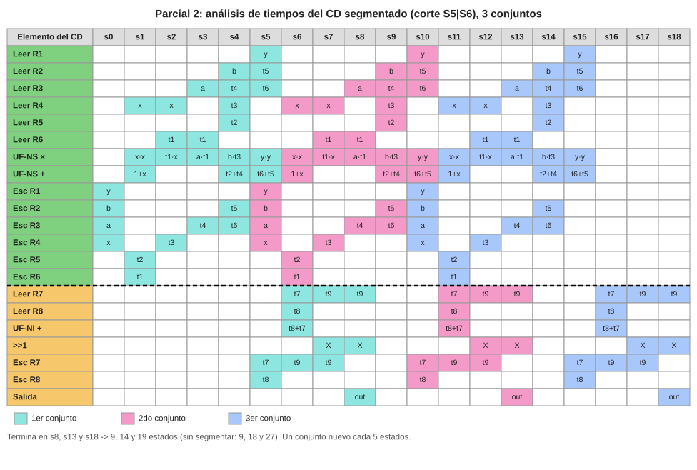

Cómo se llenó, con las reglas de 7.1:

- **s0**: carga del 1.er conjunto (Esc R1 = y, R2 = b, R3 = a, R4 = x).
- **s1–s5**: el NS hace S1–S5 del ASM. En s5 escribe t8 en R8 y t7 en R7 (cruzan el corte).
- **s5 también**: carga del 2.º conjunto (rosa). En s5 el 1.er conjunto lee y (R1), t5 (R2) y t6 (R3) por última vez, así que esos registros se pueden reescribir al final de s5. R4 está libre desde s4.
- **s6–s8**: el NI hace t9 = t8 + t7, el primer >>1 y la salida. Al mismo tiempo el NS hace S1–S3 del 2.º conjunto.
- El patrón se repite cada **5 columnas**: el 2.º conjunto sale en s13 y el 3.º en s18.

Comprobaciones de la tabla: en cada columna el × y el + del NS hacen como mucho una operación cada uno, ningún registro se escribe dos veces, y R7/R8 del 2.º conjunto se escriben en s10, cuando el 1.er conjunto ya terminó con ellos (s8).

**¿Por qué el primer conjunto no mejora (9 y no 8 como en clase)?** En la clase la primera operación del NI (la resta) no necesitaba el último resultado del NS (t4), y por eso se adelantó una columna. Aquí la primera operación del NI, t9 = t8 + t7, necesita **los dos** resultados de S5, que es el último estado del NS. No hay nada que adelantar.

### 7.6 Parcial – Paso 5: ganancia

| | 1 conjunto | 2 conjuntos | 3 conjuntos | N conjuntos |
|---|---|---|---|---|
| Sin segmentación | 9 | 18 | 27 | 9N |
| Con segmentación | 9 | 14 | 19 | 9 + 5(N − 1) |
| Diferencia | 0 | 4 | 8 | |
| **% de mejora** | **0** | **0,22** | **0,30** | → 1 − 5/9 = 0,44 |

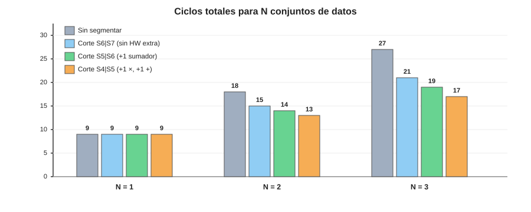

- La mejora **crece con el número de conjuntos** y tiende a 44 % (ganancia 9/5 = 1,8).
- La ideal con dos niveles sería 2 (50 %). No se alcanza porque los niveles no están equilibrados: el NS tarda 5 estados y el NI solo 3, así que el NI pasa 2 de cada 5 estados sin trabajo.

### 7.7 Qué cambia en la unidad de control

Cada columna de la tabla de tiempos es **una palabra de control** (una fila de la ROM de salida). En régimen permanente las columnas se repiten cada 5, así que la UC queda así:

| Estado UC | Qué hace el CD | Siguiente |
|---|---|---|
| S0 | espera Inicio, carga el 1.er conjunto | S1 si Inicio = 1 |
| S1–S4 | NS: S1–S4 del 1.er conjunto (llenado) | de S4: P0 si llega otro conjunto (Inicio = 1), si no V0 |
| P0 | NS: S5 del conjunto k + carga del conjunto k+1 | P1 |
| P1 | NS: S1 de k+1 · NI: S6 de k | P2 |
| P2 | NS: S2 de k+1 · NI: S7 de k | P3 |
| P3 | NS: S3 de k+1 · NI: S8 de k (out, **Final = 1**) | P4 |
| P4 | NS: S4 de k+1 | P0 si llega otro conjunto, si no V0 |
| V0 | NS: S5 del último conjunto (sin carga) | V1 |
| V1–V3 | NI: S6–S8 del último conjunto (V3: out, Final = 1) | S0 |

- 14 estados → **4 bits**. Entradas de la UC: Inicio (otro conjunto disponible) → ROM de entrada **32 × 4**.
- Palabra de control: NS (LD1; s2, LD2; s3, LD3; s4, LD4; LD5; LD6; ml 2; mr 2; al 1; ar 2 = 17 bits) + NI (s7 2 bits, LD7, LD8, h = 5 bits) = **22 bits** + Final → ROM de salida **16 × 23**.
- `Final = 1` ya no marca "terminé todo", sino "**hay un resultado válido en OUT**" (P3 y V3).

---

## 8. Resumen comparativo y lista de chequeo para el examen

| Diseño | Estados | Periodo | 1 conjunto | 3 conjuntos | Unidades | Registros | Palabra de control |
|---|---|---|---|---|---|---|---|
| Base (parcial) | 9 | T | 9 T | 27 T | 1 ×, 1 +, 1 >> | 6 | 21 bits |
| Base + buses | 9 | T | 9 T | 27 T | igual, con 4 + 2 buses | 6 | 25 bits |
| UF segmentada (× en 2 etapas) | 11 | T/2 | 5,5 T | 16,5 T | × de 2 etapas | 6 | – |
| CD segmentado (corte S5\|S6) | 9, luego 1 cada 5 | T | 9 T | 19 T | 1 ×, 2 +, 1 >> | 8 | 22 bits |

### Lo que hay que saber hacer

1. **Variables** → tabla de vida sin huecos, lado izquierdo → **6 registros**.
2. **Operadores** → nodos, arcos de incompatibilidad (estado y tipo), pesos **f/d = fuentes comunes / destinos comunes**, unir el arco más pesado y sumar pesos → **1 ×, 1 +, 1 >>**; los pesos dicen qué operando va a cada lado.
3. **Conexiones** → letras, tabla de conexiones, incompatibles = mismo estado **y distinta fuente**, juntar por fuente (lecturas) y por destino (escrituras) → **4 buses de lectura + 2 de escritura**; cuidado con las cargas simultáneas de S0.
4. **Segmentar la UF** → cortar la unidad lenta, regla "lanzada en ck → lista en ck+2", replanificar, ganancia = (9 × T)/(11 × T/2) = **1,64**.
5. **Segmentar el CD** → línea roja, agrupación de variables **por nivel**, CD de cada nivel, tabla de tiempos con colores, ganancia para 1, 2 y 3 conjuntos → **9/14/19 frente a 9/18/27**.

### Errores típicos

- Contar como incompatibles dos conexiones que llevan **el mismo dato** desde el mismo registro.
- Olvidar que en el CD segmentado **cada nivel tiene sus propias unidades** (no se puede usar el sumador del NS para el NI en el mismo estado).
- Cargar el siguiente conjunto **antes** de que el anterior lea por última vez esos registros.
- Comparar estados sin mirar el periodo cuando se segmenta la UF: 11 estados de T/2 son menos tiempo que 9 de T.
- Esperar ganancia en el primer conjunto: solo aparece si la primera operación del NI no necesita el último resultado del NS.
